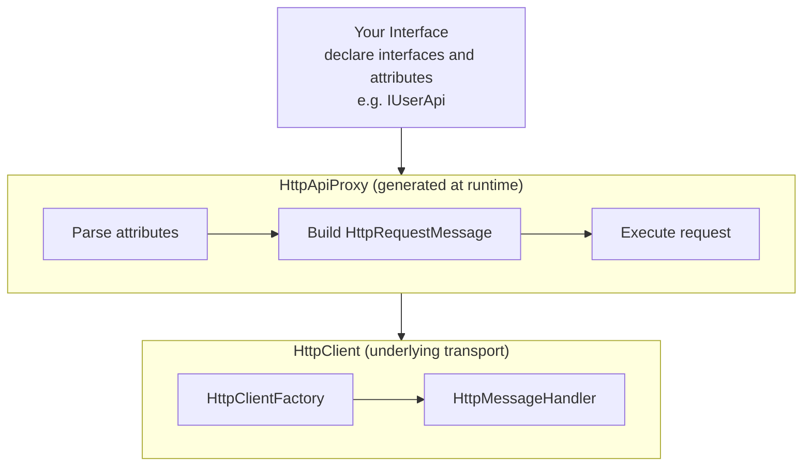
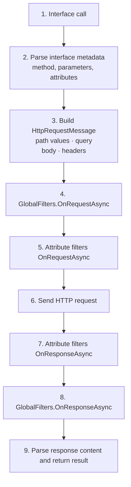

# Architecture Overview

WebApiClientCore is a declarative HTTP client framework for .NET that allows you to define HTTP requests through interfaces and attributes, eliminating the need to manually construct HttpRequestMessage.

## Core Design Philosophy

### Declarative Programming

Traditional HTTP client code:

```csharp
// Traditional approach
public async Task<User> GetUserAsync(string id)
{
    var client = _httpClientFactory.CreateClient();
    var response = await client.GetAsync($"http://api.example.com/users/{id}");
    response.EnsureSuccessStatusCode();
    var json = await response.Content.ReadAsStringAsync();
    return JsonSerializer.Deserialize<User>(json);
}
```

Using WebApiClientCore:

```csharp
// Declarative
public interface IUserApi
{
    [HttpGet("users/{id}")]
    Task<User> GetAsync(string id);
}
```

### Core Concepts



## Core Components

### 1. Attribute System

| Attribute Category | Description | Examples |
|-------------------|-------------|----------|
| HTTP Methods | Define request method and path | `[HttpGet]`, `[HttpPost]` |
| Content Attributes | Define request body format | `[JsonContent]`, `[FormContent]` |
| Return Attributes | Define response parsing method | `[JsonReturn]`, `[XmlReturn]` |
| Filters | Request/response interception | `[LoggingFilter]`, `[Timeout]` |
| Host Attributes | Define base URL | `[HttpHost]` |

### 2. IApiParameter

Self-describing parameter types that allow parameters to control their own serialization and transmission:

```csharp
public class FaceModel : IApiParameter
{
    public Bitmap Image { get; set; }
    
    public Task OnRequestAsync(ApiParameterContext context)
    {
        // Custom serialization logic
    }
}
```

### 3. IApiFilter

Filters for request and response interception:

```csharp
public class SignFilter : IApiFilter
{
    public Task OnRequestAsync(ApiRequestContext context)
    {
        // Before request: Add signature
    }
    
    public Task OnResponseAsync(ApiResponseContext context)
    {
        // After response: Log
    }
}
```

### 4. ITask\<T\>

Asynchronous tasks with conditional retry support:

```csharp
public interface IUserApi
{
    [HttpGet("users/{id}")]
    ITask<User> GetAsync(string id);
}

var user = await userApi.GetAsync(id)
    .Retry(3)
    .WhenCatch<HttpRequestException>();
```

## Request Processing Flow



## Dependency Injection

WebApiClientCore integrates deeply with ASP.NET Core's dependency injection system:

```csharp
// Register interface
services.AddHttpApi<IUserApi>()
    .ConfigureHttpApi(o =>
    {
        o.HttpHost = new Uri("http://api.example.com/");
    })
    .ConfigureHttpClient(c =>
    {
        c.Timeout = TimeSpan.FromSeconds(30);
    });

// Usage
public class UserService
{
    private readonly IUserApi _userApi;
    
    public UserService(IUserApi userApi)
    {
        _userApi = userApi;
    }
}
```

## Extension Packages

| Package Name | Function |
|--------------|----------|
| WebApiClientCore | Core package |
| WebApiClientCore.Extensions.OAuths | OAuth2 and token management |
| WebApiClientCore.Extensions.NewtonsoftJson | Newtonsoft.Json support |
| WebApiClientCore.Extensions.JsonRpc | JSON-RPC protocol support |
| WebApiClientCore.OpenApi.SourceGenerator | OpenAPI code generation tool |

## Comparison with Other Solutions

| Feature | WebApiClientCore | Refit | HttpClient |
|---------|------------------|-------|------------|
| Declarative Interface | ✅ | ✅ | ❌ |
| Compile-time Checking | ✅ | ✅ | ❌ |
| Conditional Retry | ✅ ITask | ❌ | ❌ |
| Custom Parameter Serialization | ✅ IApiParameter | ❌ | ✅ |
| OAuth Extension | ✅ | Manual implementation | Manual implementation |
| AOT Support | ✅ | ❌ | ✅ |

## Next Steps

- [Getting Started](../overview/getting-started.md)
- [HTTP Attributes](../core/http-attributes.md)
- [Content Attributes](../core/content-attributes.md)
- [Exception Handling](../configuration/exception-handling.md)
